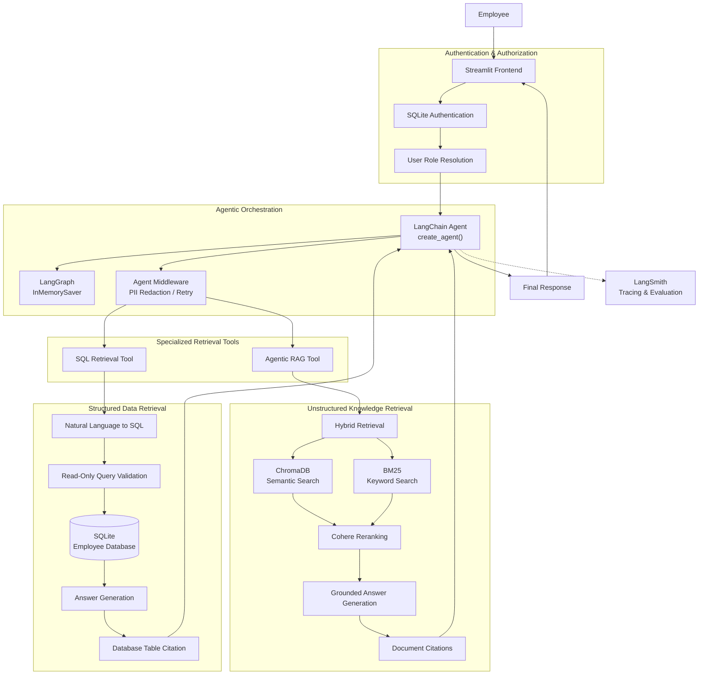
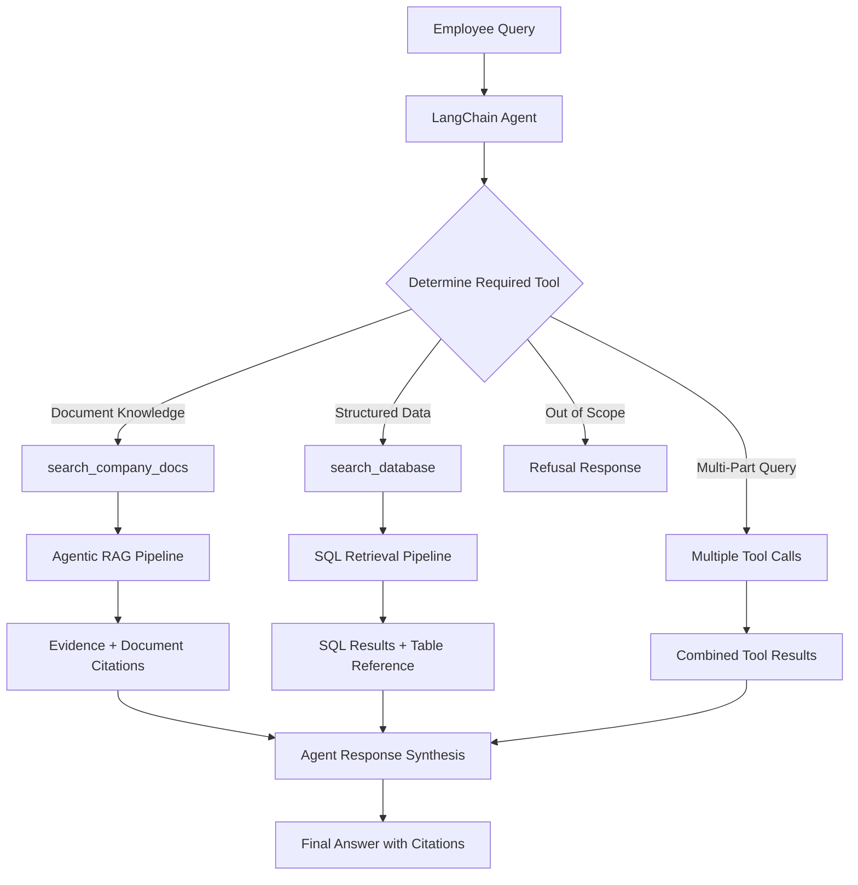
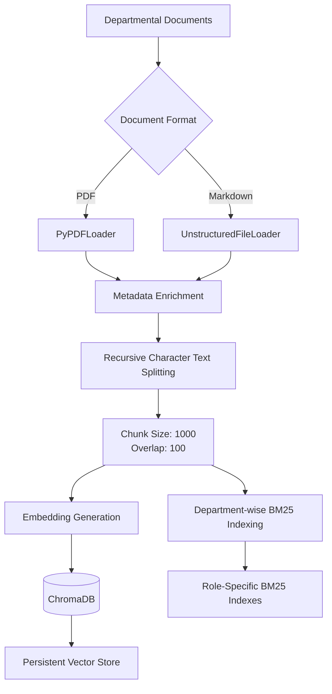
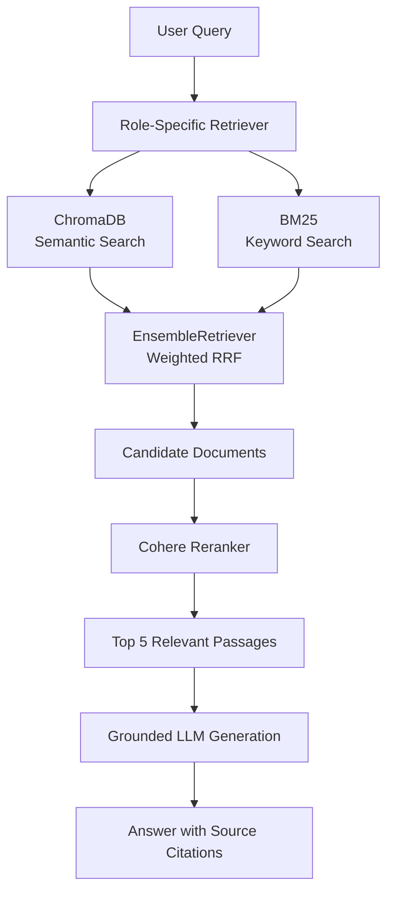
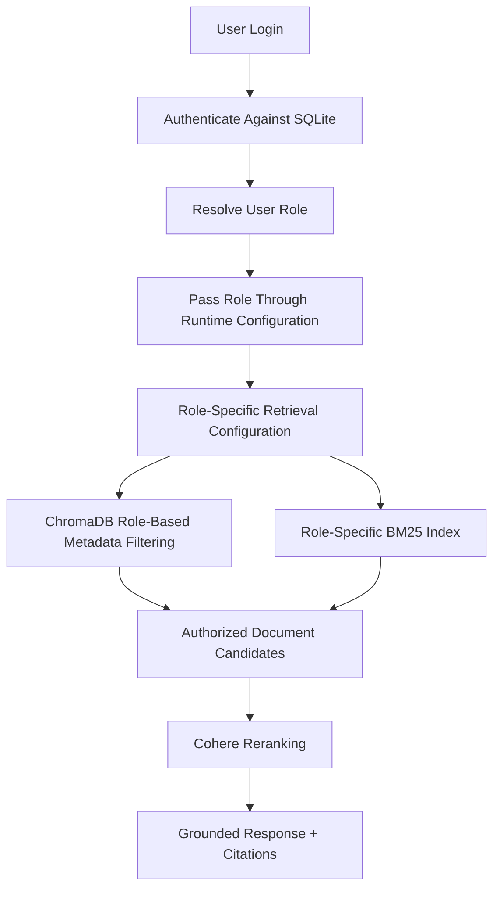
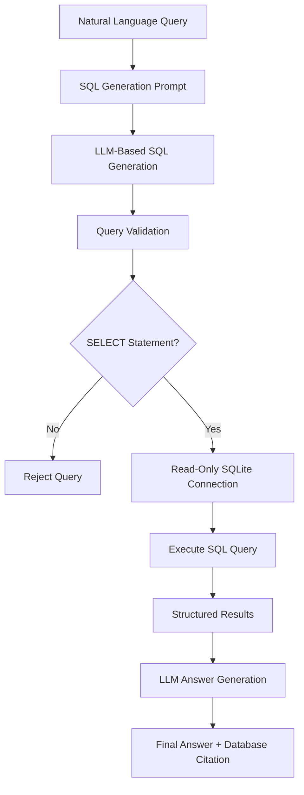
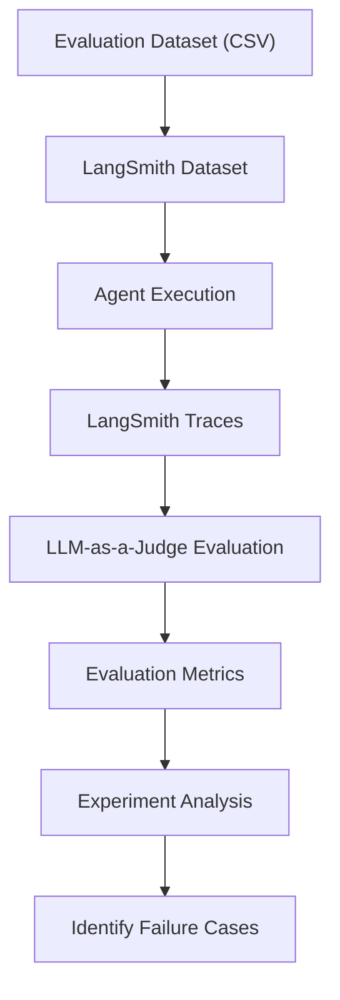

# Role-Aware Enterprise AI Assistant

An end-to-end **Agentic RAG-powered enterprise knowledge assistant** that enables employees to query internal company documents and structured databases using natural language. The application combines role-based access control, hybrid retrieval, contextual reranking and source citations to deliver evidence-backed responses while respecting departmental data-access boundaries.


## Application Preview

### Streamlit Assistant


*Conversational interface for querying enterprise documents and structured employee data, with role-aware responses and source citations.*

### LangSmith Evaluation


*Agent execution traces and evaluation results used to inspect response quality, task completion, tool reliability and latency.*

---

### Key Features

- **Agentic RAG:** Autonomous tool selection and multi-step execution using LangChain's `create_agent()`.
- **Multi-format Ingestion:** PDF and Markdown document ingestion with metadata enrichment and recursive text chunking.
- **Hybrid Retrieval:** Combines ChromaDB semantic search and BM25 keyword search using weighted ensemble retrieval.
- **Contextual Reranking:** Cohere Rerank improves retrieval precision by selecting the most relevant passages.
- **Role-Based Access Control (RBAC):** Role-based metadata filtering at the vector retrieval layer and role-specific BM25 indexes.
- **Natural Language to SQL:** Converts employee-related questions into read-only SQLite queries.
- **Source Citations:** Generates evidence-backed responses with document names, page numbers and database table references.
- **Privacy Middleware:** Custom LangChain middleware for phone-number redaction.
- **Short-Term Memory:** Thread-scoped conversation memory using LangGraph's `InMemorySaver`.
- **Evaluation & Observability:** LangSmith tracing and LLM-as-a-judge evaluation.

---

## 1. Problem Statement

Enterprise information is often distributed across multiple systems and formats.

Employees may need to search through departmental documents, internal policies, technical reports and structured databases to find relevant information.

Traditional chatbots and basic RAG implementations have several limitations:

- They primarily retrieve information from unstructured documents.
- They cannot directly answer structured database queries.
- They often lack granular access-control mechanisms.
- They may generate answers without verifiable source citations.
- They struggle with complex questions requiring multiple retrieval operations.

This project addresses these challenges by building a unified **role-aware enterprise AI assistant** that combines Agentic RAG with structured database retrieval.

The application allows employees to ask questions in natural language while ensuring that document retrieval and database access follow predefined authorization policies.

## 2. System Architecture

The application follows a modular architecture consisting of an authentication layer, an agent orchestration layer, specialized retrieval tools and their respective data stores.



### Technology Stack

| Component | Technology |
|---|---|
| Programming Language | Python |
| Frontend | Streamlit |
| Agent Orchestration | LangChain `create_agent()` |
| Agent Checkpointing | LangGraph |
| LLM Inference | Groq API |
| Vector Database | ChromaDB |
| Embedding Model | Hugging Face `all-MiniLM-L6-v2` |
| Keyword Search | BM25 |
| Hybrid Retrieval | LangChain EnsembleRetriever |
| Contextual Reranking | Cohere Rerank |
| Structured Database | SQLite |
| Document Loaders | PyPDFLoader, UnstructuredFileLoader |
| Text Splitting | RecursiveCharacterTextSplitter |
| Evaluation & Observability | LangSmith |
| Dependency Management | uv |

---

## 3. Agentic RAG Architecture

The application uses LangChain's `create_agent()` to implement an agent capable of dynamically selecting and invoking specialized retrieval tools.

Instead of relying on hardcoded routing rules or semantic routing, the LLM determines which tools are required based on the user's query.

### Available Tools

| Tool | Responsibility |
|---|---|
| `search_company_docs` | Retrieves information from internal documents using the Agentic RAG pipeline. |
| `search_database` | Retrieves structured employee information using Natural Language to SQL. |

### Agent Capabilities

- Dynamic tool selection based on user intent.
- Multiple tool invocations for complex, multi-part queries.
- Query decomposition into smaller sub-questions.
- Synthesis of information from multiple retrieval operations.
- Evidence-grounded response generation with source citations.
- Authorization-aware handling of tool outputs.

### Agent Execution Workflow



The agent uses custom middleware for phone-number redaction, model retries and tool retries. A recursion limit is configured to prevent uncontrolled tool execution.

---

## 4. Multi-Format Document Ingestion

The document ingestion pipeline supports two formats:

- PDF
- Markdown (`.md`)

Documents are organized into departmental directories, allowing the application to associate each document with its corresponding access-control metadata.

### Ingestion Workflow



### Ingestion Techniques

| Stage | Implementation |
|---|---|
| Document Loading | PyPDFLoader and UnstructuredFileLoader |
| Supported Formats | PDF and Markdown |
| Metadata Enrichment | Department/role, source filename and page number |
| Chunking Strategy | RecursiveCharacterTextSplitter |
| Chunk Size | 1,000 characters |
| Chunk Overlap | 100 characters |
| Embedding Generation | Hugging Face Sentence Transformers |
| Vector Storage | Persistent ChromaDB |
| Keyword Indexing | Department-specific BM25 indexes |

### Metadata Enrichment

Each document chunk retains metadata used during retrieval and citation generation.

```python
{
    "role": "engineering",
    "source": "engineering_guidelines.pdf",
    "page": 5
}
```

This metadata serves two important purposes:

1. **Authorization:** Enables role-based metadata filtering during vector retrieval.
2. **Traceability:** Enables source citations containing document names and page numbers.

Markdown documents do not have page numbers, so their citations use the document name.

---

## 5. Hybrid Retrieval: Semantic Search + Keyword Search

The RAG pipeline combines semantic search and keyword search to improve retrieval coverage across different query types.

Relying exclusively on vector similarity can sometimes underperform when queries contain exact technical terminology, names or identifiers.

Hybrid retrieval addresses this limitation by combining two complementary retrieval strategies.

### 5.1 Semantic Search — ChromaDB

Semantic search retrieves documents based on the similarity between query embeddings and stored document embeddings.

**Embedding model:** `all-MiniLM-L6-v2`

Benefits:

- Captures semantic relationships between queries and documents.
- Handles paraphrasing and conceptually similar questions.
- Retrieves relevant information even when exact keywords differ.

### 5.2 Keyword Search — BM25

BM25 retrieves documents using lexical keyword matching based on term frequency and inverse document frequency.

Benefits:

- Effective for exact terminology and technical keywords.
- Handles named entities and domain-specific vocabulary.
- Complements semantic search when exact keyword matching is important.

### 5.3 Weighted Ensemble Retrieval

Both retrieval strategies are combined using LangChain's `EnsembleRetriever`.

| Retriever | Weight | Top-K |
|---|---:|---:|
| ChromaDB Semantic Search | 0.5 | 10 |
| BM25 Keyword Search | 0.5 | 10 |

The ensemble combines the ranked retrieval results using weighted Reciprocal Rank Fusion (RRF), rather than directly comparing raw similarity and BM25 scores.

### 5.4 Contextual Compression and Cohere Reranking

Initial hybrid retrieval generates candidate passages. These are subsequently passed through LangChain's `ContextualCompressionRetriever`.

The application uses Cohere's `rerank-english-v3.0` model to evaluate candidate passages against the original query.

**Reranking configuration:** Top 5 passages.

This second-stage relevance assessment helps:

- Prioritize the most relevant retrieved passages.
- Reduce irrelevant context passed to the generation model.
- Improve the quality of evidence used for answer generation.

### Complete Retrieval Pipeline



---

## 6. Role-Based Access Control (RBAC)

A central requirement of an enterprise assistant is ensuring that users can access only information authorized for their roles.

The application implements role-based access control at the retrieval and tool-execution layers.

### Role and Department Mapping

| User Role | Accessible Departments |
|---|---|
| C-Level | General, Engineering, Marketing, Finance |
| Engineering | General, Engineering |
| Marketing | General, Marketing |
| Finance | General, Finance |
| General | General |

### Role-Based Metadata Filtering

The application uses different mechanisms for enforcing access restrictions across its two retrieval systems.

**ChromaDB — Role-Based Metadata Filtering**

The user's authorized departments are passed as metadata filters during vector retrieval.

Example:

```python
search_kwargs = {
    "k": 10,
    "filter": {
        "role": {
            "$in": ["general", "engineering"]
        }
    }
}
```

The vector database therefore retrieves only documents belonging to the departments accessible to the user.

**BM25 — Role-Specific Indexes**

BM25Retriever does not provide the same metadata-filtering mechanism as ChromaDB.

To address this limitation, separate BM25 indexes are created for different roles:

- Complete index for C-Level users.
- Engineering index.
- Marketing index.
- Finance index.
- General index.

The appropriate BM25 index is selected using the authenticated user's role.

### Authorization Flow



### Structured Database Authorization

Database access is restricted to C-Level users.

The authorization check is implemented in application code before executing the SQL retrieval pipeline.

The LLM is not trusted to determine user permissions.

---

## 7. Natural Language to SQL

The assistant also supports queries over structured employee information stored in SQLite.

A separate SQL retrieval tool translates natural-language questions into executable SQL statements.

### SQL Pipeline



### Implemented Safeguards

- **Schema-constrained generation:** The LLM receives the predefined database schema and is instructed to use only existing tables and columns.
- **Read-only SQL:** Only `SELECT` statements are accepted.
- **Read-only database connection:** SQLite is opened using `mode=ro`.
- **Result-size limitation:** Non-aggregated queries are instructed to include `LIMIT 50`.
- **Error handling:** Invalid SQL and database execution errors are handled explicitly.
- **Role authorization:** Only C-Level users can access the employee database.

### SQL Generation Considerations

The SQL generation prompt also accounts for:

- Case-insensitive string matching using `LOWER()` and `LIKE`.
- Numeric casting to avoid integer division issues.
- Self-joins for hierarchical employee and manager queries.
- Restrictions against data modification and schema alteration.

The final response is generated using the SQL results rather than allowing the LLM to invent database information.

Database responses include table-level source citations.

---

## 8. Source Citations and Grounded Generation

A key design objective is ensuring that generated responses are traceable to their underlying information sources.

The application uses retrieved metadata to generate source citations.

### Document Citations

Document-based responses include:

- Source document name.
- Page number, when available.

Example:

```text
The employee leave policy allows employees to carry
forward eligible unused leave.

Source: leave_policy.pdf, Page 5
```

For Markdown documents, the citation contains the source filename without a page number.

### Database Citations

SQL-based responses reference the source database table.

Example:

```text
There are 25 employees in the Engineering department.

Source: employees
```

### Citation Preservation in Tool Execution

The RAG tool uses LangChain's `response_format="content_and_artifact"`.

This separates:

- Tool message content: The generated answer.
- Tool artifact: The retrieved document objects containing source metadata.

This allows the application to preserve retrieved documents and their citation metadata without unnecessarily serializing the full document objects into the main agent's subsequent LLM context.

The main agent is instructed to preserve source citations when synthesizing tool responses.

---

## 9. Security, Guardrails and Middleware

The application incorporates multiple mechanisms to improve information security, privacy and execution reliability.

| Mechanism | Implementation |
|---|---|
| Authentication | SQLite-based username/password authentication |
| Authorization | Role-Based Access Control |
| Document Security | Role-based metadata filtering |
| BM25 Security | Role-specific indexes |
| SQL Security | C-Level authorization and read-only SQL execution |
| PII Protection | Custom phone-number redaction middleware |
| Grounding | Context-constrained answer generation |
| Source Traceability | Document and database citations |
| Model Reliability | ModelRetryMiddleware |
| Tool Reliability | ToolRetryMiddleware |
| Execution Control | Configured recursion limit |

### Custom Phone-Number Redaction Middleware

A custom LangChain `AgentMiddleware` implementation intercepts tool responses and redacts matching Indian phone-number patterns before the tool output is returned to the agent.

This demonstrates how middleware can be used to implement privacy controls across tool execution.

### Retry Middleware

The application uses:

- `ModelRetryMiddleware(max_retries=2)`
- `ToolRetryMiddleware(max_retries=2)`

These provide retry handling for model and tool execution failures.

### Recursion Control

A recursion limit of 20 is configured to prevent uncontrolled agent execution.

### Important Security Consideration

This is a portfolio prototype demonstrating enterprise-oriented security patterns, not a production-certified security implementation.

Production deployment would additionally require password hashing, stronger identity management, comprehensive SQL validation, database-level access controls and audit logging.

---

## 10. Short-Term Conversational Memory

The application implements thread-scoped short-term conversational memory using LangGraph's `InMemorySaver`.

### Implementation

- Each successful login generates a unique conversation thread ID.
- The thread ID is passed through LangChain's runtime configuration.
- LangGraph maintains conversation state within the corresponding thread.
- Different sessions receive separate conversation contexts.
- Logging out clears the corresponding Streamlit session state.

This enables conversational continuity without implementing a persistent long-term memory store.

---

## 11. LangSmith — Evaluation and Observability

LangSmith is integrated to monitor agent execution and evaluate response quality.

The evaluation framework uses a CSV-based evaluation dataset and LLM-as-a-judge methodology.

### Observability

LangSmith tracing provides visibility into:

- Agent execution traces.
- Individual LLM invocations.
- Tool selection and invocation sequences.
- Intermediate execution steps.
- Model and tool latency.
- Errors during execution.

### Evaluation Workflow



### Evaluation Metrics

The evaluation framework covers the **RAG Triad** as well as agent-level quality and operational metrics. The RAG Triad evaluates retrieval quality and answer generation from three complementary perspectives:

| Evaluation area | Metric | Objective |
|---|---|---|
| RAG Triad | **Context Relevance** | Evaluates whether the retrieved context is relevant to the user's query. |
| RAG Triad | **Faithfulness (Groundedness)** | Evaluates whether the generated response is supported by the retrieved context and does not introduce unsupported claims. |
| RAG Triad | **Answer Relevance** | Evaluates whether the generated response directly and appropriately addresses the user's query. |
| Agent evaluation | **Correctness** | Evaluates whether the response provides the expected answer. |
| Agent evaluation | **Task Success Rate** | Measures the proportion of test cases successfully completed by the agent. |
| Agent evaluation | **Tool Failure Rate** | Measures the frequency of unsuccessful tool executions. |
| Operational evaluation | **Latency** | Measures the time required to complete agent responses. |

Together, these seven metrics assess retrieval quality, grounded answer generation, task completion and operational reliability. Numerical scores are intentionally not reported here; results should be taken from the corresponding LangSmith evaluation runs.

---

## 12. Application Screenshots

### Streamlit Application

#### Login Interface


#### Chat Interface


#### Role-Based Access Demonstration


#### Agentic RAG Response with Citations


#### Natural Language to SQL


### LangSmith

#### Agent Execution Traces


#### Evaluation Experiment


#### Evaluation Metrics


---

## 13. Project Structure

```text
role-aware-enterprise-assistant/
│
├── resources/
│   └── organisation_data/
│       ├── engineering/
│       ├── finance/
│       ├── marketing/
│       └── general/
│
├── chroma_db/
│   └── Persistent vector database
│
├── bm25_index/
│   └── Role-specific BM25 indexes
│
├── evaluation/
│   ├── Evaluation dataset
│   └── Evaluation scripts
│
├── auth.py
│   └── SQLite-based authentication
│
├── chat_agent.py
│   └── Main agent, middleware and memory
│
├── knowledge_retrieval.py
│   └── Agentic RAG and hybrid retrieval
│
├── database_retrieval.py
│   └── Natural Language to SQL
│
├── data_ingestion.py
│   └── Multi-format ingestion and indexing
│
├── streamlit_app.py
│   └── Streamlit frontend
│
├── company.sqlite3
│   └── Employee database
│
├── users.sqlite3
│   └── Authentication database
│
├── pyproject.toml
├── uv.lock
└── README.md
```

---

## 14. Installation and Setup

### Prerequisites

- Python 3.11+
- uv package manager
- Groq API key
- Cohere API key
- LangSmith API key (for tracing and evaluation)

### Step 1: Clone the Repository

```bash
git clone https://github.com/NavenduSingh17/role-aware-enterprise-assistant.git

cd role-aware-enterprise-assistant
```

### Step 2: Install Dependencies

```bash
uv sync
```

### Step 3: Configure Environment Variables

Create a `.env` file in the project root.

```env
GROQ_API_KEY=your_groq_api_key
COHERE_API_KEY=your_cohere_api_key

LANGCHAIN_TRACING_V2=true
LANGCHAIN_API_KEY=your_langsmith_api_key
LANGCHAIN_PROJECT=role-aware-enterprise-assistant
```

Never commit API keys or other secrets to version control.

### Step 4: Ingest Documents

Place departmental PDF and Markdown files inside their respective directories under:

```text
resources/organisation_data/
```

Run the ingestion pipeline:

```bash
uv run python data_ingestion.py
```

This processes the documents, generates embeddings, populates ChromaDB and creates role-specific BM25 indexes.

**Note:** The current ingestion script rebuilds the vector collection and BM25 indexes from the configured document corpus. Run ingestion again after updating the documents.

### Step 5: Launch the Application

```bash
uv run streamlit run streamlit_app.py
```

Open the local URL displayed by Streamlit.

---

## 15. Engineering Decisions and Trade-offs

| Design Decision | Rationale |
|---|---|
| Agentic RAG instead of hardcoded routing | Allows dynamic tool selection, multiple tool calls and complex query handling. |
| Hybrid retrieval instead of vector search alone | Combines semantic understanding with exact keyword matching. |
| Cohere reranking | Improves the relevance of retrieved context before generation. |
| Role-based metadata filtering | Enforces document access restrictions at the retrieval layer. |
| Separate BM25 indexes | Compensates for the lack of equivalent metadata filtering in BM25Retriever. |
| Separate RAG and SQL tools | Uses specialized retrieval mechanisms for unstructured and structured data. |
| LangGraph checkpointing | Provides thread-scoped short-term conversational memory. |
| LangChain middleware | Centralizes retry handling and PII redaction. |
| LangSmith | Provides execution tracing and systematic LLM-based evaluation. |
| Source citations | Improves traceability and makes generated responses easier to verify. |

---

## 16. Future Enhancements

Potential improvements towards a production-grade enterprise deployment:

- FastAPI backend to decouple the frontend from agent execution.
- Incremental document ingestion and automated index updates.
- Enterprise authentication and SSO integration.
- Fine-grained document-level access control.
- Persistent conversation storage.
- Comprehensive SQL validation and database-level authorization.
- Automated testing and CI/CD integration.
- Docker-based deployment and cloud infrastructure.
- Structured audit logging and production monitoring.

---

## Author

**Navendu Singh**

[GitHub Profile](https://github.com/NavenduSingh17)

[Project Repository](https://github.com/NavenduSingh17/role-aware-enterprise-assistant)

---

*An exploration of Agentic RAG, enterprise knowledge retrieval, role-aware AI systems, hybrid search and LLM evaluation.*
